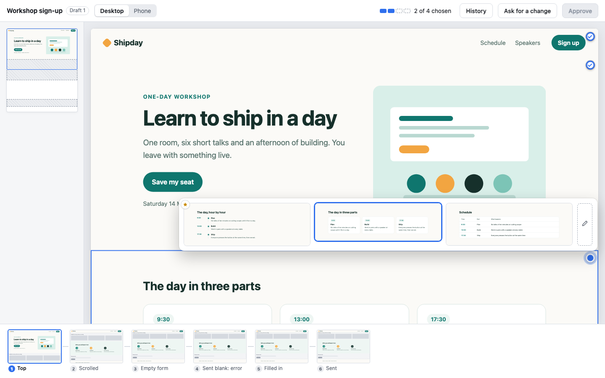

# picky-eater

**Build web pages like a storyboard: the agent sketches, you pick, it builds what you approved.**

picky-eater is an open-source [Agent Skill](https://agentskills.io) for coding agents such as Claude
Code, OpenAI Codex and Cursor. A manga artist draws a rough storyboard, decides how each panel is
staged, and the page becomes a finished manuscript panel by panel. picky-eater makes web pages the
same way:

1. Your coding agent draws a **rough page** once, with a few drawn options for each area that matters.
2. You open a private page in your browser and **point at the dots**. Each option is a small drawing
   of the real result. Pointing at one shows it on the page; clicking keeps it.
3. The grey sketch turns into a finished mockup. You **approve**, and the agent builds exactly that.
4. The built page is **measured against what you approved**, at the same widths and moments, and
   the agent fixes what differs.

For a page that already exists there is nothing to sketch: the dots sit on **your real page**,
running on your own development server, and each option is a small change laid over it. That
works on static sites and on apps that redraw themselves: React, Vue, Svelte, Solid, Angular,
Next.js, Nuxt, SvelteKit, Astro and others ([what is tested](docs/compatibility.md#frontend-frameworks)).



[Try the interactive demo](https://telicity-ai.github.io/pe-www/) to see how the review works.

## Why

- **You decide by looking, not by reading.** No questionnaires and no design vocabulary. The options
  are drawings, shown on the page itself, at desktop and phone width.
- **It behaves like a page.** The page scrolls inside a frame of real screen height, so sticky
  bars, scroll effects and form controls work. Flows (empty form → error → sent) are a strip of
  cuts under the page, and pressing a button in the page moves to the next cut.
- **Your page stays your page.** On an existing page everything you do not change is the real
  thing: your styles, your scripts, your hot reload. An option is tried out on it and taken back
  without a trace, and it stays in place while your framework redraws the page around it.
- **It knows where things come from.** On a running app the agent asks the page itself which
  component and source file draw each part, instead of reading through your project.
- **Few tokens.** The agent writes the storyboard once. Choosing, previewing and switching cuts
  happen in your browser by combining pre-written pieces. Options you do not pick are never
  implemented.
- **Grounded options.** The agent picks what to offer from a [pattern catalog](docs/patterns.md)
  researched from established UI/UX books and public design systems: 146 layouts, controls and
  motions and 50 recurring decisions, each with rules, sources and real products that use it.
- **It moves where that helps, and nowhere else.** Where a page could move (a button that is
  pressed, a section that opens, content that appears), motion is an option like any other, and
  "it does not move" is always one of them. A motion is only offered where it passes four
  questions: how often the moment is met, what the motion is for, whether it fits its time, and
  whether it gets in the way. It plays on your page in the review, at full speed, slowed down, or
  as people get it who asked for less motion.
- **It says why, if you ask.** Point at the mark of the suggested option to read the reason and
  what was considered and left out. Otherwise the options stay drawings.
- **It remembers what you chose.** The next time, the mark sits where you chose before: at once
  in the same project, and in other projects once a choice has repeated. It is a file on your
  machine that you can read, switch off and delete.
- **Approved means built.** Before writing code the agent measures the approved page: positions,
  sizes, styles and a picture of every area. Afterwards the built page is measured the same way,
  and every difference is one line the agent has to fix or explain. You can see approved and built
  side by side.
- **Only you approve.** Approval is a click in the review page. The agent has no command for it.

## Install

Requires Node.js 22 or newer. From your project root:

```sh
npx skills add telicity-ai/picky-eater --skill picky-eater -a claude-code codex cursor -y
```

For Claude Code you can also use the plugin marketplace:

```
/plugin marketplace add telicity-ai/picky-eater
/plugin install picky-eater@telicity-ai
```

Other ways are in [docs/installation.md](docs/installation.md). Nothing is added to your
application's dependencies: the skill folder contains one self-contained script.

## Use

Ask your agent in plain words:

> I need a sign-up page for our workshop. Show me options before you build it.

The agent studies your project, draws the storyboard and gives you a link such as
`http://127.0.0.1:4173/#token=…`. On that page:

| You do | What happens |
|---|---|
| Point at a dot | Its options appear beside it, as drawings |
| Point at an option | The page shows it. Move away and it is gone |
| Click an option | It stays. The area turns from sketch to finished |
| Click a cell of the page miniature on the left | The page scrolls there and opens that area's options. This also works from the keyboard |
| Click a cut in the strip at the bottom, or press a button in the mockup | The page moves to that moment: scrolled, form empty, error, sent |
| Point at the star of an option | Why it is suggested, and what was left out |
| **Replay**, **Slow**, **Reduced** (on a board that offers motion) | What moves when it appears plays again; everything runs at a quarter of its speed; the options are shown as people get them who asked for less motion |
| **Ask for a change** | The agent redraws only that area. Your other choices are kept |
| **Approve** | Available once every area is chosen. The agent starts building |

Or, for a page you already have (with your development server running):

> Our pricing page feels flat. Show me a few ways to arrange the plan cards before you change it.

To try it without an agent, see [examples/new-screen](examples/new-screen/README.md),
[examples/static-site](examples/static-site/README.md) and
[examples/react-app](examples/react-app/README.md).

## How it works

```
coding agent ── reads SKILL.md, writes a draft ──▶ picky-eater CLI (one bundled file, no dependencies)
                                                      │ new · signin · inspect · recommend · validate · propose · preview · wait · implement · check · report · taste
                                                      ▼
your browser ◀── http://127.0.0.1:<port> ──▶ review listener ──▶ <project>/.picky-eater/
  review page: top bar · page miniature · the page · cut strip
     the page, new screen:    a mockup in a sandbox that cannot run scripts
     the page, existing page: your app ◀── http://127.0.0.1:<other port> ── stage listener ──▶ your dev server
```

- A **board** is one `board.json` plus small HTML fragments: a page frame, a rough sketch and two to
  four options per area, and a list of cuts. `validate` checks it; `propose` freezes it as a revision.
- The review page composes the page from those pieces in the browser. The mockup is rendered in a
  sandboxed frame that cannot run scripts or load anything from the network.
- Over an existing page the board holds no markup at all, only **patches**: CSS first, then moving
  or changing existing elements (their listeners survive), then inserted markup, and a short
  script only where nothing else can show the behavior (marked "Approximate"). Your app is shown
  from a second local address, so that it and the review page are different origins: they can only
  exchange messages, and nothing the app says can choose or approve.
- A framework redraws its page whenever something changes. A patch is put back before the next
  paint when the app replaces what it changed, and steps aside when the app wants an element back
  that the patch has moved. On pages that are sent from the server and then taken over (Next.js,
  Nuxt, SvelteKit, Astro), patches wait until the framework has done so.
- An app screen is mostly lists, and they grow while you look. A patch on every row reaches the
  rows that arrive later, and `each` does its operations inside every row or card.
- `inspect` prints a map of a running page: for each part a selector that finds it, and the
  component and source file that draw it, also in a repository of several packages. It goes
  closer on request (one part down to its buttons, or the page after a click: an open dialog).
  `validate` holds the board against the running page before you see it.
- `recommend` looks at the running page and prints, by rule, the moments where it could move,
  which motions of the catalog pass at each and which are left out with the reason, and what you
  chose before. The agent draws from that. What it leaves out goes into the board and is shown
  behind the suggested mark.
- When you approve, the review listener writes down what was offered and what you took, as
  catalog ids, in `~/.picky-eater/taste/`. The next draft's suggested mark moves to what you chose
  if that speaks clearly enough. The agent can propose a rule from something you said; only you
  can keep it, in the History panel.
- A page behind a sign-in: the agent signs its own headless browser in once with your project's
  development account (`signin`), and you sign in yourself inside the preview. Your browser's
  session is never read or copied.
- After approval, `implement` and `check` drive a Chrome, Edge or Chromium that is already
  installed, without a window, and compare the built page with the approved one: every text,
  control, picture and painted box is paired by its role and text, in the order a person reads
  them, so the implementation is free to use its own markup. On a running page a time ("36m",
  "10:28 AM") is paired as a time: a minute later it is not a difference.
- Everything is stored as plain files in `.picky-eater/` in your repository: revisions, your
  choices, change requests, approvals, the measurements and a history of what changed.

Design and plan: [docs/concept.md](docs/concept.md); what is offered and suggested, and why: [docs/recommendation.md](docs/recommendation.md). Board format:
[new screens](skills/picky-eater/references/board.md),
[existing pages](skills/picky-eater/references/live.md). Building and comparing:
[build.md](skills/picky-eater/references/build.md).

## Status

Version 0.2 is a rewrite. What works today, and what is planned:

| | |
|---|---|
| New screens: storyboard → choices → approved mockup | Works. Tested in Chromium |
| Pattern catalog and `picky-eater patterns` | Works |
| Motion as an option: where a page moves, and where it does not | Works, with CSS only: 20 motion patterns and 10 decisions, `recommend`, play marks, Replay, Slow and Reduced in the review, and motion in `implement` and `check` with a reduced-motion pass ([recommendation.md](docs/recommendation.md#status)) |
| Reasons and remembered choices | Works: the note behind the suggested mark, choices recorded at approval, the mark moved by earlier choices, rules that the person keeps |
| Storyboard over a page that already exists: static sites and server-rendered pages | Works. Tested in Chromium with [examples/static-site](examples/static-site/README.md) |
| Automatic comparison of the built page with the approved mockup (`implement`, `check`, `report`) | Works. Needs an installed Chrome, Edge or Chromium |
| Framework apps: patches that survive re-renders and hot updates, component and source file of each area | Works. Run against the development servers of 14 stacks, among them Vite with React, Vue, Svelte, Solid and Preact, Next.js, Nuxt, SvelteKit, Astro, React Router, Angular, webpack, Parcel and Rsbuild ([compatibility](docs/compatibility.md#frontend-frameworks)) |
| Pages behind a sign-in | Works where the sign-in is on your machine: the agent signs its headless browser in with the development account (`signin`), you sign in inside the preview. A sign-in through an identity provider elsewhere cannot be played |
| A product screen, not a sample page | Run on the web client of [T3 Code](https://github.com/pingdotgg/t3code) by hand and by Claude Code: lists that grow, a dialog drawn by a route, a monorepo, a build in component files of 1,800 and 3,800 lines that compares as built as approved ([what was found](docs/compatibility.md#a-real-product-t3-code)) |

## Security and privacy

- Runs on your machine. No accounts, API keys, telemetry or network requests.
- What you chose before is kept in `~/.picky-eater/taste/` as ids of options and catalog patterns,
  never as texts of your pages. `picky-eater taste` shows it, `--off` stops it for a project,
  `--forget-all` deletes it.
- The review server listens on loopback only, checks the `Host` header, and needs a random token
  that travels in the link's fragment and is never stored in a cookie.
- Mockups are checked when published, sanitized again in the browser and drawn in a frame that
  cannot run scripts, under a Content Security Policy that loads nothing from anywhere.
- Your app is framed from another origin and only reached by messages. It cannot read the review
  page, its token or its storage, cannot navigate it, and nothing it sends counts as a choice.
  The address it is shown from forwards only to a development server on this machine.
- The command line can read the state and stop the server. Choosing, asking for changes and
  approving are only possible from the review page.

Details and limits: [SECURITY.md](SECURITY.md).

## FAQ

**What is picky-eater?**
An open-source Agent Skill (MIT) that makes a coding agent show you drawn options for each part
of a web page before it writes code. You pick in your browser and approve, and the agent builds
the page you approved.

**How do I get Claude Code, Codex or Cursor to show me design options before it codes?**
[Install](#install) the skill and ask for a page in plain words. The agent prepares two to four
options for each area that matters and gives you a local link. It writes the real code only after
you press Approve.

**Which coding agents does it work with?**
It follows the [Agent Skills](https://agentskills.io) format. It has been run end to end with
Claude Code and the OpenAI Codex CLI; Cursor is not tested yet
([compatibility](docs/compatibility.md#coding-agents)).

**Is picky-eater on npm?**
Yes. The [npm package](https://www.npmjs.com/package/picky-eater) exposes the CLI with
`npx picky-eater --help`. To use picky-eater from a coding agent, follow the [skill installation steps](#install).

**Does it work with React, Next.js, Vue or Svelte?**
Yes. On a page that exists, the options are laid over your running app. That is run against the
development servers of 14 stacks ([the list](docs/compatibility.md#frontend-frameworks)).

**Does it send my code or my pages anywhere?**
No. It runs on your machine and makes no network requests. There are no accounts, API keys or
telemetry.

**What does it add to my project?**
The skill folder with one self-contained script, and a `.picky-eater/` folder of plain files for
drafts, choices and approvals. Nothing is added to your application's dependencies.

## Repository

| Path | Contents |
|---|---|
| `skills/picky-eater/` | The skill: `SKILL.md`, references and the bundled CLI |
| `catalog/` | The pattern catalog (JSON), the source of `docs/patterns.md` |
| `src/` | TypeScript sources of the CLI, the two listeners, the review page and the script that runs in your app |
| `examples/new-screen/` | A complete board for a new screen |
| `examples/static-site/` | A small site with its development server, and a board over it |
| `examples/react-app/` | A React app (Vite, TypeScript) with a board over its settings page |
| `tests/` | Unit, integration and browser tests; `tests/stacks/` runs the tool against real development servers |
| `docs/` | Concept and plan, pattern catalog, installation, compatibility |
| `llms.txt` | A summary and an index of the documentation for AI assistants ([llmstxt.org](https://llmstxt.org)) |

## Contributing

See [CONTRIBUTING.md](CONTRIBUTING.md). Security reports: [SECURITY.md](SECURITY.md).

## License

[MIT](LICENSE)
